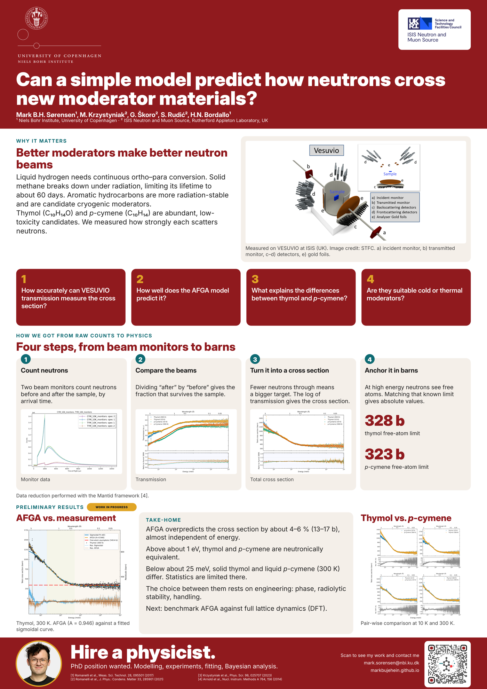
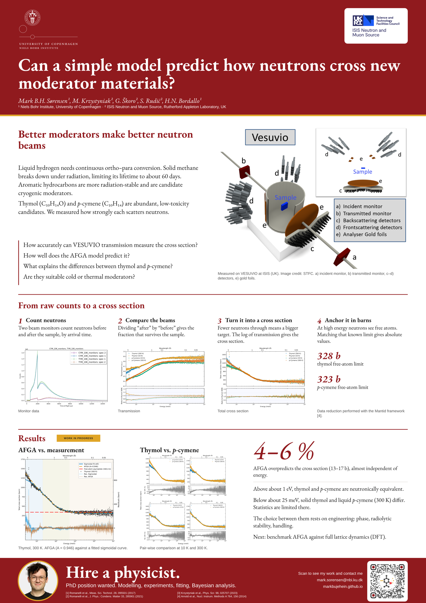
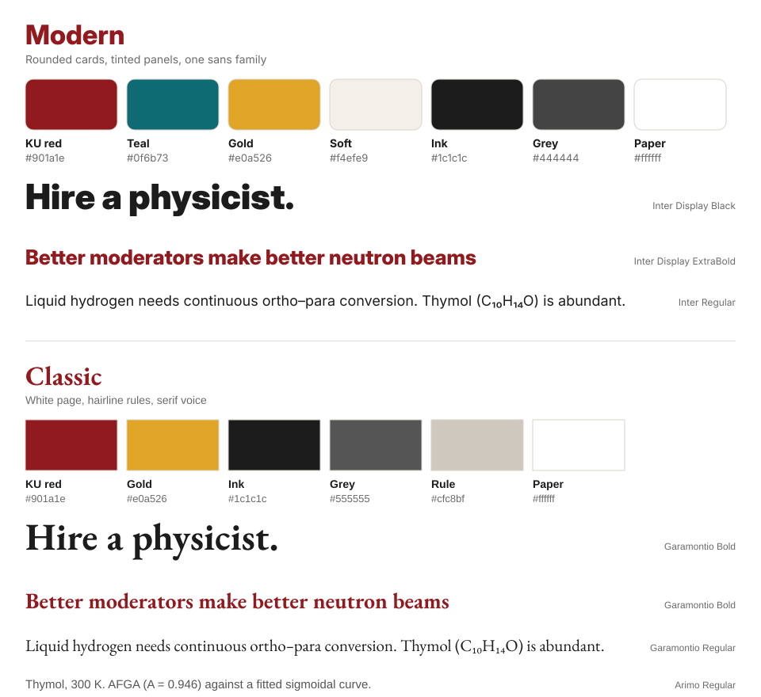

# MSc thesis poster

Two A0 posters for the ESS DMSC School 2026, a modern and a classic layout: *Can a simple model predict how neutrons cross new moderator materials?*
Based on an MSc thesis at the Niels Bohr Institute, University of Copenhagen, with ISIS Neutron and Muon Source.

| Modern | Classic |
|---|---|
|  |  |

## Layout

```
src/
  build_modern.py      modern poster: Inter Display and Inter, rounded cards
  build_classic.py     classic poster: white page, Garamond-style serif, free-flowing blocks
  make_qr.py           restyles assets/qr_base.svg (thymol QR) per poster and checks it decodes
  make_palette.py      draws docs/palette.svg for the README
  *.designcraft/.idml  editable documents, written by the builds
  assets/              figures and logos placed on the poster
build/                 all build output (see below)
docs/                  PRINT_SETTINGS.md (HP DesignJet) and palette.svg
reference/             local only, not tracked: KU templates, thesis, inspiration
```

## Build

Needs `designcraft-cli` and `pdfcraft-cli` on the path, Pillow, and the Inter, Inter Display, Garamontio and Arimo fonts installed.

```
python3 src/build_modern.py
python3 src/build_classic.py
python3 src/make_qr.py   # only to regenerate src/assets/qr_*.pdf; needs rsvg-convert and zbarimg
```

Each script writes its own set to `build/`, prefixed `modern_` or `classic_`:

| File | What it is |
|---|---|
| `*_trim.pdf` | A0 (841 × 1189 mm), no bleed. For screens and sharing |
| `*_print.pdf` | A0 plus 3 mm bleed and trim marks. Send this to the printer |
| `*_preview.png`, `*_build.txt`, `*_run.log`, `*_steps.json` | preview image, generated script, and logs |

The script exits non-zero if text is overset or a tool fails.

The PDFs are not tracked in git. They are attached to the [releases](https://github.com/markbujehein/msc-thesis-poster/releases).

## Design

Design based on:

- [Templates](https://www.ku.dk/designguide/en/templates) ([Skabeloner](https://www.ku.dk/designguide/skabeloner))
- [Design Guide](https://www.ku.dk/designguide/en) ([Designguide](https://www.ku.dk/designguide/))

Each poster has its own palette and type. The image is drawn by `src/make_palette.py`, with the fonts converted to outlines so it looks the same without them installed.



| Colour | Modern | Classic |
|---|---|---|
| KU red `#901a1e` | header, footer, headings, cards | masthead, footer, headings, rules |
| Teal `#0f6b73` | kickers, step numbers | |
| Gold `#e0a526` | highlights, portrait ring | masthead line, status tag, portrait ring |
| Soft `#f4efe9` | panel backgrounds | |
| Ink `#1c1c1c` | body text | body text |
| Grey | `#444444`, captions | `#555555`, captions |
| Rule `#cfc8bf` | | hairlines |

- Modern: Inter Display for headings and Inter for text.
- Classic: Garamontio, a Garamond-style serif, for title, headings and body, and Arimo (the Nerd Font build) for captions, affiliations and references.
